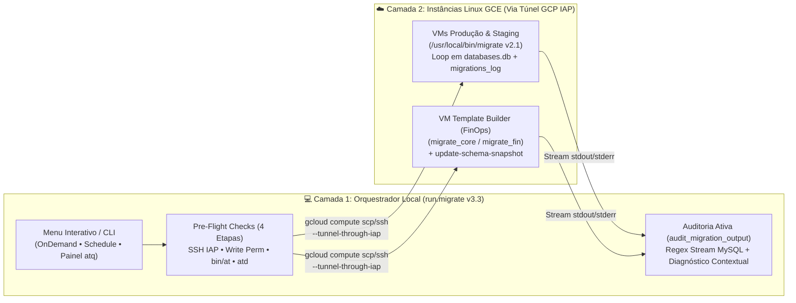

# 🗄️ MySQL Zero-Trust Migration Orchestrator (`run.migrate v3.3`) — Under the Hood Architecture

**Author:** Mariucha de Paula Rocha — *DevOps & SRE Engineer*  
⚖️ **Copyright © 2026 Mariucha de Paula Rocha — All Rights Reserved ([`LICENSE`](../LICENSE))**

> 🔒 **Intellectual Property & Live Demo Notice:**  
> Este documento apresenta a arquitetura detalhada, o fluxo de comandos e o motor de auditoria do orquestrador `run.migrate v3.3`. O código-fonte executável completo reside no repositório privado da autora e é demonstrado **ao vivo durante entrevistas técnicas**. Todos os nomes de projetos e instâncias utilizam identificadores genéricos (`acme-*-pool`).

---

## 🇧🇷 1. Escopo Executivo & Problema Resolvido (Português)

Em ambientes SaaS multi-tenant e dedicados em nuvem (**Google Cloud Platform**), a aplicação de scripts SQL (DDL/DML) em múltiplos servidores MySQL/Percona historicamente apresenta cinco desafios críticos de confiabilidade:
1. **Fragmentação de Scripts:** Uso de scripts separados para execução imediata (*OnDemand*) e agendada (*Linux `at`*), gerando divergência operacional.
2. **Falhas Silenciosas em Agendamentos Noturnos:** Ausência de validação prévia do daemon `atd` ou de permissões de escrita antes do envio do arquivo SQL.
3. **Falsos Positivos de Deploy (Exit Code 0 Mascarado):** Scripts remotos que iteram sobre múltiplos schemas (`databases.db`) frequentemente retornam `exit 0` para o túnel SSH mesmo quando o MySQL rejeita queries em bancos específicos (`ERROR 1062 Duplicate entry`, `ERROR 1142 Command denied`, `ERROR 1146 Table doesn't exist`).
4. **Visibilidade Descentralizada de Filas (`atq`):** Necessidade de conectar via SSH máquina por máquina para auditar ou cancelar migrações agendadas.
5. **Custos Ociosos de Nuvem (FinOps):** Instâncias de construção de schemas molde (*Template Builders*) esquecidas ligadas após janelas de manutenção.

O **`run.migrate v3.3`** unifica todo esse ciclo em um único orquestrador interativo em Bash, operando 100% via túneis criptografados **GCP Identity-Aware Proxy (IAP)** sem exposição de IPs públicos.

---

## ⚙️ 2. Arquitetura "Debaixo do Capô" (Camada Local vs. Camada Remota)

A operação é dividida em **duas camadas integradas**:



---

## 🔬 3. Comandos Executados em Cada Ambiente (Passo a Passo)

Ao executar localmente:
```bash
./run.migrate REL-2026-001.sql
```
O orquestrador executa a seguinte cadeia de comandos por baixo do capô conforme o ambiente selecionado:

### 3.1. Descoberta Dinâmica de Zona & Pre-Flight Checks (Comum a Todos os Ambientes)
```bash
# 1. Consulta dinâmica da zona da VM na API do GCP (com fallback estático em ZONES):
gcloud compute instances list --project="<GCP_PROJECT>" --filter="name=(<VM_NAME>)" --format="value(zone)"

# 2. Pre-Flight 1 — Conectividade SSH via Túnel Zero-Trust IAP:
gcloud compute ssh "<VM_NAME>" --project="<GCP_PROJECT>" --zone="<ZONE>" --tunnel-through-iap --quiet --command="exit 0"

# 3. Pre-Flight 2 — Permissão de escrita no diretório remoto de deploy:
gcloud compute ssh "<VM_NAME>" --project="<GCP_PROJECT>" --zone="<ZONE>" --tunnel-through-iap --quiet --command="test -w /opt/deploy/migrations"

# 4. Pre-Flight 3 e 4 (Apenas Modo Schedule) — Binário 'at' e daemon 'atd' ativo:
gcloud compute ssh "<VM_NAME>" --project="<GCP_PROJECT>" --zone="<ZONE>" --tunnel-through-iap --quiet --command="command -v at >/dev/null 2>&1"
gcloud compute ssh "<VM_NAME>" --project="<GCP_PROJECT>" --zone="<ZONE>" --tunnel-through-iap --quiet --command="systemctl is-active --quiet atd || service atd status >/dev/null 2>&1"
```

---

### 3.2. Matriz de Comandos por Ambiente ([`environments.example.conf`](./environments.example.conf))

| Opção no Menu (`Pool Lógico`) | Projeto GCP (`GCP_PROJECTS`) | Instância(s) Alvo (`VM`) | Zona | Comando de Upload (`scp`) e Execução Remota (`ssh`) | Escopo de Schemas Afetados |
| :--- | :--- | :--- | :---: | :--- | :--- |
| **`1) enterprise-alpha-pool`** | `acme-alpha-prod-pool` | `alpha-dedicated-db-01` | `us-east1-c` | **Upload:** `gcloud compute scp "REL-2026-001.sql" "alpha-dedicated-db-01:/opt/deploy/migrations/..." --tunnel-through-iap`<br>**OnDemand:** `--command="cd /opt/deploy/migrations && migrate REL-2026-001.sql"`<br>**Schedule:** `--command="echo 'cd /opt/deploy/migrations && migrate REL-2026-001.sql' \| at <ISO_TIME>"` | Schema dedicado Alpha listado em `databases.db` |
| **`2) core-saas-prod-pool`** | `acme-core-prod-pool` | `[1] core-appdb-prod-01`<br>`[2] core-showcase-prod-01` | `us-east1-b`<br>`us-east1-c` | **Upload:** `gcloud compute scp ... "<VM>:/opt/deploy/migrations/..." --tunnel-through-iap`<br>**OnDemand:** `--command="cd /opt/deploy/migrations && migrate REL-2026-001.sql"` | Schemas Multi-Tenant SaaS (`core-appdb-prod-01`) ou Demo/Showcase (`core-showcase-prod-01`) |
| **`3) enterprise-beta-pool`** | `acme-beta-prod-pool` | `[1] beta-dedicated-db-01`<br>`[2] beta-staging-db-01` | `us-east1-c`<br>`us-east1-d` | **Upload:** `gcloud compute scp ... "<VM>:/opt/deploy/migrations/..." --tunnel-through-iap`<br>**OnDemand:** `--command="cd /opt/deploy/migrations && migrate REL-2026-001.sql"` | Produção Dedicada Beta ou Homologação Beta |
| **`4) saas-staging-pool`** | `acme-staging-test-pool` | `staging-appdb-01` | `us-east1-c` | **Upload:** `gcloud compute scp ... "staging-appdb-01:/opt/deploy/migrations/..." --tunnel-through-iap`<br>**OnDemand:** `--command="cd /opt/deploy/migrations && migrate REL-2026-001.sql"` | Todos os schemas de QA / Homologação listados em `databases.db` |
| **`5) financial-prod-pool`** | `acme-fin-prod-pool` | `fin-cluster-db-01` | `us-east1-c` | **Upload:** `gcloud compute scp ... "fin-cluster-db-01:/opt/deploy/migrations/..." --tunnel-through-iap`<br>**OnDemand:** `--command="cd /opt/deploy/migrations && migrate REL-2026-001.sql"` | Schemas produtivos da vertical financeira (`databases.db`) |
| **`6) template-builder`** *(Submenu 1 - Core)* | `acme-staging-test-pool` | `template-builder-vm` | `us-east1-b` | **1. Auto-Start FinOps:** `gcloud compute instances start "template-builder-vm" ...` + `sleep 20`<br>**2. Upload SCP via IAP**<br>**3. Execução:** `--command="cd /opt/deploy/migrations && migrate_core REL-2026-001.sql && sudo update-schema-snapshot"`<br>**4. Auto-Stop FinOps:** `gcloud compute instances stop "template-builder-vm" ...` | **Exclusivamente** o schema molde `_template_core_db` + atualização de dump no Git |
| **`6) template-builder`** *(Submenu 2 - Financial)* | `acme-staging-test-pool` | `template-builder-vm` | `us-east1-b` | **1. Auto-Start FinOps** ➔ **2. Upload SCP** ➔ **3. Execução:** `--command="cd /opt/deploy/migrations && migrate_fin REL-2026-001.sql && sudo update-schema-snapshot"` ➔ **4. Auto-Stop FinOps** | **Exclusivamente** o schema molde `_template_fin_db` + atualização de dump no Git |

---

### 3.3. Painel Consolidado Global de Agendamentos (Opção 3 do Menu — `manage_scheduled_jobs`)
* **Varredura Universal (`atq`):** Percorre todas as VMs mapeadas executando:
  ```bash
  gcloud compute ssh "<VM_NAME>" --project="<GCP_PROJECT>" --zone="<ZONE>" --tunnel-through-iap --quiet --command="atq"
  ```
* **Cancelamento Cirúrgico (`<JOB_ID>`) ou em Lote (`all`):**
  ```bash
  gcloud compute ssh "<VM_NAME>" --project="<GCP_PROJECT>" --zone="<ZONE>" --tunnel-through-iap --quiet --command="atrm <JOB_ID>"
  ```

---

## 🗄️ 4. O que Roda Dentro da VM: Os 4 Scripts Remotos (`/usr/local/bin/*`)

| Binário Remoto na VM | Onde Reside | Operação Interna no MySQL |
| :--- | :--- | :--- |
| **`/usr/local/bin/migrate`** *(v2.1)* | VMs de Produção e Staging | 1. Lê `/opt/deploy/migrations/databases.db` removendo duplicatas (`awk '!seen[$0]++'`).<br>2. Conecta via loopback TCP (`HOST="127.0.0.1"`, `USER="root"` com `ALL PRIVILEGES` para suportar DDLs como `DROP`/`RENAME TABLE` sem atrelar a execução a contas nominais de analistas).<br>3. Aplica o SQL em cada banco e registra auditoria em `INSERT INTO migrations_log (script_name, executed_at) VALUES ('<SQL>', NOW());`. |
| **`/usr/local/bin/migrate_core`** | `template-builder-vm` | Aplica o script SQL estritamente no schema molde da Plataforma Core (`_template_core_db`). |
| **`/usr/local/bin/migrate_fin`** | `template-builder-vm` | Aplica o script SQL estritamente no schema molde da Plataforma Financial (`_template_fin_db`). |
| **`/usr/local/bin/update-schema-snapshot`** | `template-builder-vm` | Exporta o `mysqldump` atualizado dos schemas molde e realiza `git commit` + `git push` para o repositório de provisionamento de novos ambientes. |

---

## 🛡️ 5. Motor de Auditoria Ativa Anti-Falso Positivo (`audit_migration_output`)

Durante execuções *OnDemand*, o `run.migrate` captura o stream remoto via *Process Substitution* (`> >(tee "$VM_EXEC_TMP")`) e analisa códigos de erro nativos do MySQL em tempo real:

* **`ERROR 1045` (Autenticação):** Orienta verificar `USER/HOST/PASSWORD` no `/usr/local/bin/migrate` da VM.
* **`ERROR 1142 / 1227` (Permissão DDL Negada):** Orienta garantir `USER="root"` no motor remoto para operações que exigem `DROP`/`CREATE`/`ALTER`.
* **`ERROR 1050 / 1060 / 1061 / 1062` (Conflito / Duplicidade):** Alerta que a tabela, coluna, índice ou registro já existe no schema (verificar se a migration já foi aplicada ou utilizar `IGNORE`).
* **`ERROR 1054 / 1091 / 1146` (Objeto Ausente):** Alerta que a tabela ou coluna referenciada não existe no schema alvo.

Se qualquer banco apresentar erro, o banner verde é bloqueado, a lista de bancos com falha e sucesso parcial é exibida sem vírgulas residuais e o script encerra com **`exit 1`**.

---

## 🇺🇸 6. English Summary — Under the Hood Execution Flow

1. **Zero-Trust Transport (`GCP IAP`):** All SSH pre-flight checks, SCP file transfers, `atq` queue audits, and SQL executions run over `gcloud compute ssh/scp --tunnel-through-iap` without public IP exposure.
2. **Two-Tier Architecture:**
   * **Tier 1 (Local Orchestrator — `run.migrate`):** Handles interactive menus, Brazilian date conversion (`DD/MM/YYYY` ➔ `YYYY-MM-DD`), 4-step pre-flight validation, FinOps auto-start/stop for `template-builder-vm`, and real-time output stream auditing (`audit_migration_output`).
   * **Tier 2 (Remote VM Engines — `/usr/local/bin/migrate*`):** Iterates over `/opt/deploy/migrations/databases.db` using `root@127.0.0.1` (`ALL PRIVILEGES`), records audit trails in `migrations_log`, or updates isolated template schemas (`migrate_core` / `migrate_fin` + `sudo update-schema-snapshot`).
