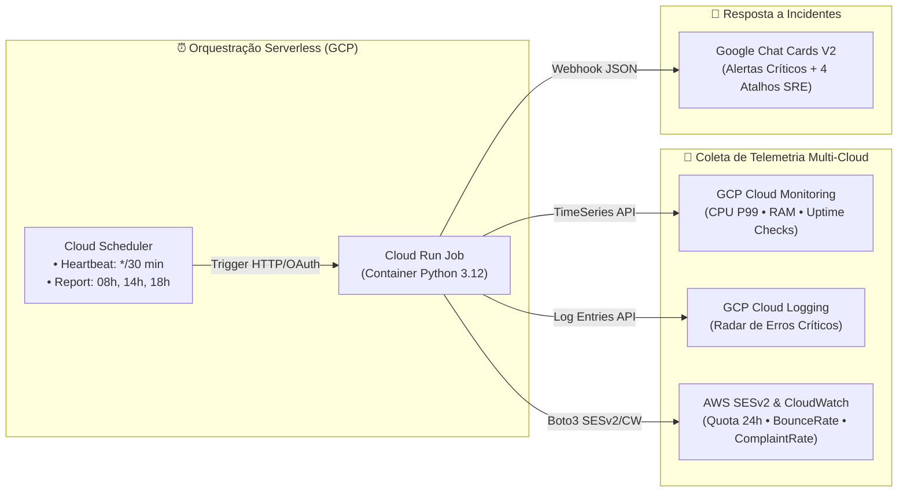

# 🛰️ Multi-Cloud Serverless SRE Monitor (`GCP Cloud Run Jobs` + `AWS SESv2`) — Architecture Case Study

**Author:** Mariucha de Paula Rocha — *DevOps & SRE Engineer*  
⚖️ **Copyright © 2026 Mariucha de Paula Rocha — All Rights Reserved ([`LICENSE`](../LICENSE))**

> 🔒 **Intellectual Property & Live Demo Notice:**  
> Este documento apresenta a arquitetura de engenharia, o fluxo de coleta multi-cloud e trechos-chave (*snippets*) do motor de monitoramento serverless. O código-fonte executável completo (`main.py` e `Dockerfile`) reside no repositório privado da autora e é demonstrado **ao vivo durante entrevistas técnicas**.

---

## 🇧🇷 1. O Problema de Engenharia & Escopo da Solução (Português)

Em arquiteturas SaaS distribuídas entre **Google Cloud Platform (GCP)** (Compute Engine, bancos de dados e microsserviços) e **Amazon Web Services (AWS)** (mensageria transacional crítica via Amazon SES), equipes de SRE enfrentam três desafios:
1. **Silos de Observabilidade:** Métricas de CPU/Memória/Uptime ficam no GCP Cloud Monitoring, enquanto métricas de reputação de entrega de e-mail (`BounceRate` e `ComplaintRate`) ficam na AWS (`SESv2` e `CloudWatch`).
2. **Fadiga de Alertas vs. Silêncio Perigoso:** Checagens contínuas geram spam nos canais da equipe se enviarem mensagens a cada execução, mas relatórios apenas diários atrasam a detecção de incidentes (**MTTD elevado**).
3. **Custo de Monitoramento Dedicado:** Manter uma VM ligada 24x7 apenas para rodar scripts de coleta gera custo fixo desnecessário.

### A Solução Serverless (`02-multicloud-sre-monitor`)
Uma aplicação em **Python 3.12** empacotada em container **Docker** (`python:3.12-slim`) e executada de forma 100% *serverless* via **Google Cloud Run Jobs** acionado pelo **Cloud Scheduler**:
* **Modo `HEARTBEAT` (A cada 30 minutos):** Audita silenciosamente todas as métricas de GCP e AWS; só dispara alerta no Google Chat se algum indicador ultrapassar o limiar crítico de SLI/SLO.
* **Modo `REPORT` (Boletins Executivos — 08h, 14h e 18h):** Envia um panorama completo em **Google Chat Cards V2** com botões de ação direta para os Dashboards de War Room e FinOps.

---

## 🏗️ 2. Diagrama de Arquitetura Multi-Cloud



---

## 🔬 3. Trecho Demonstrativo de Engenharia (Snippet)

Abaixo está um trecho ilustrativo da lógica de avaliação combinada de reputação **AWS SESv2 + CloudWatch** para proteção proativa contra bloqueio de envio (*Account Sending Pause*):

```python
# Copyright (c) 2026 Mariucha de Paula Rocha - All Rights Reserved
def evaluate_ses_reputation(bounce_rate: float, complaint_rate: float, quota_pct: float) -> dict:
    """
    Avalia SLIs de reputação do Amazon SESv2 contra os limiares da AWS:
    - Bounce Rate: Warning >= 3.0% | Critical >= 5.0%
    - Complaint Rate: Warning >= 0.05% | Critical >= 0.1%
    """
    status = "HEALTHY"
    alerts = []

    if bounce_rate >= 5.0 or complaint_rate >= 0.1:
        status = "CRITICAL"
        alerts.append(f"Risco de bloqueio SES (Bounce: {bounce_rate:.2f}%, Complaint: {complaint_rate:.3f}%)")
    elif bounce_rate >= 3.0 or complaint_rate >= 0.05 or quota_pct >= 85.0:
        status = "WARNING"
        alerts.append(f"Atenção nos indicadores SES (Quota utilizada: {quota_pct:.1f}%)")

    return {"status": status, "alerts": alerts}
```

---

## 🚀 4. Pipeline de Build e Deploy em Produção (Cloud Build + Cloud Run Job)

```bash
# 1. Compilação e publicação da imagem no Artifact Registry via Google Cloud Build:
gcloud builds submit --project="acme-core-prod-pool" \
  --tag "us-central1-docker.pkg.dev/acme-core-prod-pool/sre-monitor-repo/gcp-monitor-job:latest" .

# 2. Atualização atômica do Cloud Run Job preservando variáveis de ambiente e Secrets:
gcloud run jobs update gcp-monitor-job \
  --project="acme-core-prod-pool" \
  --region="us-central1" \
  --image="us-central1-docker.pkg.dev/acme-core-prod-pool/sre-monitor-repo/gcp-monitor-job:latest" \
  --quiet

# 3. Disparo de validação imediata em nuvem:
gcloud run jobs execute gcp-monitor-job --project="acme-core-prod-pool" --region="us-central1" --wait
```

---

## 🇺🇸 5. English Summary

* **Serverless Multi-Cloud Observability:** Built with Python 3.12, Docker, Google Cloud Run Jobs, and Cloud Scheduler.
* **Dual Execution Mode:** Runs every 30 minutes in silent `HEARTBEAT` mode (alerting only on SLI/SLO breaches to eliminate alert fatigue) and 3 times a day in executive `REPORT` mode via interactive **Google Chat Cards V2**.
* **Unified Telemetry:** Correlates GCP Compute Engine/Cloud Monitoring metrics and Cloud Logging error signatures with AWS SESv2/CloudWatch email deliverability indicators (`BounceRate` and `ComplaintRate`).
