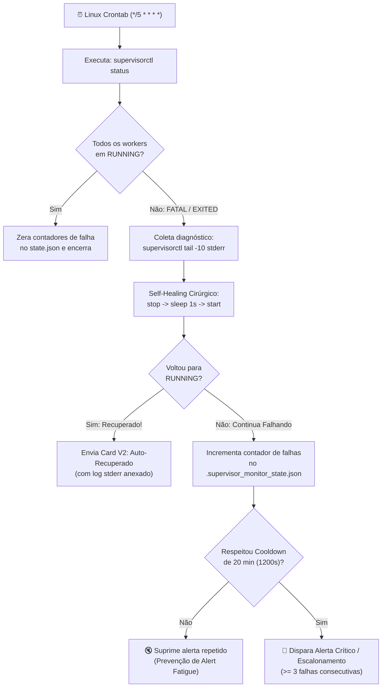

# 🔄 Process Self-Healing & Anti-Noise Watchdog (`supervisor_monitor.py`) — Architecture Case Study

**Author:** Mariucha de Paula Rocha — *DevOps & SRE Engineer*  
⚖️ **Copyright © 2026 Mariucha de Paula Rocha — All Rights Reserved ([`LICENSE`](../LICENSE))**

> 🔒 **Intellectual Property & Live Demo Notice:**  
> Este documento apresenta a arquitetura de engenharia, a máquina de estados de autorrecuperação e trechos-chave (*snippets*) do daemon de *Self-Healing*. O código-fonte completo (`supervisor_monitor.py`) reside no repositório privado da autora e é demonstrado **ao vivo durante entrevistas técnicas**.

---

## 🇧🇷 1. O Problema de Engenharia & Escopo da Solução (Português)

Em servidores Linux de produção que processam filas assíncronas e workers em background gerenciados pelo **Supervisor (`supervisord`)**, ocorrem três dores operacionais clássicas:
1. **Toil Manual de Madrugada:** Quando um worker entra em estado `FATAL`, `EXITED` ou `BACKOFF` (por queda momentânea de rede ou limite de memória), um analista precisava conectar via SSH para reiniciar o processo e ler os logs.
2. **Falta de Contexto no Alerta:** Alertas tradicionais avisam apenas que o processo caiu, sem trazer as linhas de erro (`stderr`) que causaram a parada.
3. **Tempestade de Alertas (*Alert Fatigue*):** Se uma rotina de monitoramento roda a cada 5 minutos no Crontab e um serviço está com falha crônica de código, ela dispara dezenas de mensagens repetidas no chat da equipe.

### A Solução de Self-Healing (`03-supervisor-self-healing`)
Um agente autônomo em **Python 3** executado a cada **5 minutos via Linux Crontab**:
1. **Varredura Nativa:** Inspeciona `supervisorctl status` identificando qualquer worker fora do estado saudável (`RUNNING`).
2. **Restart Cirúrgico em 2 Etapas:** Executa `supervisorctl stop <worker>` ➔ `sleep 1s` ➔ `supervisorctl start <worker>`, garantindo liberação limpa de sockets/locks antes da subida.
3. **Coleta Automática de Diagnóstico (`stderr`):** Captura automaticamente as últimas 10 linhas de erro via `supervisorctl tail -10 <worker> stderr` e anexa no card de notificação.
4. **Controle de Estado com Cooldown Anti-Ruído (20 min) e Escalonamento:** Persiste o histórico em JSON (`.supervisor_monitor_state.json`), silenciando alertas repetidos por 20 minutos e escalonando para **Incidente Crônico** caso o processo falhe por **3 tentativas consecutivas**.

---

## 🏗️ 2. Fluxograma da Máquina de Estados (Self-Healing & Anti-Noise)



---

## 🔬 3. Trecho Demonstrativo de Engenharia (Snippet)

Abaixo está um trecho ilustrativo do motor de **Self-Healing em 2 etapas + Trava de Cooldown Anti-Ruído**:

```python
# Copyright (c) 2026 Mariucha de Paula Rocha - All Rights Reserved
def attempt_surgical_heal(process_name: str, state: dict, now_ts: float, cooldown_sec: int = 1200) -> dict:
    """Executa stop -> sleep 1s -> start e aplica controle de cooldown anti-ruído."""
    subprocess.run(["supervisorctl", "stop", process_name], capture_output=True, text=True)
    time.sleep(1)
    res = subprocess.run(["supervisorctl", "start", process_name], capture_output=True, text=True)

    recovered = "started" in res.stdout.lower()
    proc_state = state.get(process_name, {"failures": 0, "last_alert_ts": 0})

    if recovered:
        state[process_name] = {"failures": 0, "last_alert_ts": now_ts}
        return {"recovered": True, "should_notify": True, "chronic": False}

    proc_state["failures"] += 1
    should_notify = (now_ts - proc_state["last_alert_ts"]) >= cooldown_sec
    if should_notify:
        proc_state["last_alert_ts"] = now_ts
    state[process_name] = proc_state

    return {
        "recovered": False,
        "should_notify": should_notify,
        "chronic": proc_state["failures"] >= 3,
    }
```

---

## 🇺🇸 4. English Summary

* **Automated Toil Reduction & MTTR Optimization:** Python watchdog scheduled every 5 minutes via Linux Crontab to monitor critical `supervisord` workers.
* **Surgical 2-Step Recovery & Root-Cause Context:** Performs a clean `stop` ➔ `sleep 1s` ➔ `start` cycle and automatically attaches the last 10 lines of `stderr` (`supervisorctl tail`) to the Google Chat Card V2 notification.
* **Stateful Anti-Noise Cooldown:** Tracks failure counts and timestamps in a local JSON state file, enforcing a 20-minute alert cooldown and escalating chronic incidents after 3 consecutive failed recovery attempts.
