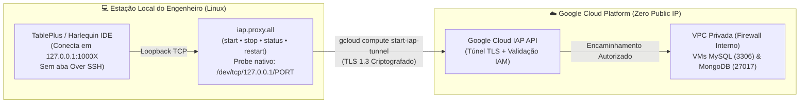

# 🔐 Zero-Trust TCP Tunnel Manager via GCP IAP (`iap.proxy.all`) — Architecture Case Study

**Author:** Mariucha de Paula Rocha — *DevOps & SRE Engineer*  
⚖️ **Copyright © 2026 Mariucha de Paula Rocha — All Rights Reserved ([`LICENSE`](../LICENSE))**

> 🔒 **Intellectual Property & Live Demo Notice:**  
> Este documento apresenta a arquitetura de conectividade Zero-Trust, o fluxo de gerenciamento de sockets TCP locais e trechos-chave (*snippets*) do utilitário `iap.proxy.all`. O código-fonte executável completo reside no repositório privado da autora e é demonstrado **ao vivo durante entrevistas técnicas**.

---

## 🇧🇷 1. O Problema de Engenharia & Escopo da Solução (Português)

Em infraestruturas de banco de dados em nuvem (**MySQL, Percona e MongoDB** no Google Compute Engine), expor portas de banco (`3306` / `27017`) ou IPs públicos na internet cria uma superfície crítica de ataque. Por outro lado, gerenciar dezenas de comandos `gcloud compute start-iap-tunnel` manualmente no terminal gera:
1. **Processos Duplicados e Conflitos de Porta:** Tentativas de abrir túneis em portas locais já ocupadas sem verificação prévia.
2. **Falta de Visibilidade Instantânea:** Dificuldade para saber rapidamente quais bancos de Produção ou Staging estão com túnel ativo (`ONLINE`) ou caído (`OFFLINE`).
3. **Processos Órfãos em Background:** Túneis antigos travados consumindo memória local.

### A Solução (`04-gcp-iap-tunnel-manager`)
Um gerenciador CLI em **Bash** (`iap.proxy.all`) que lê o mapa declarativo de túneis ([`tunnels.example.conf`](./tunnels.example.conf)) e orquestra todo o ciclo de vida (`start`, `stop`, `status`, `restart`) usando **descritores nativos de socket TCP do Bash (`/dev/tcp/127.0.0.1/<PORT>`)**.

---

## 🏗️ 2. Arquitetura de Conectividade Zero-Trust (Sem IPs Públicos)



---

## 🔬 3. Trecho Demonstrativo de Engenharia (Snippet)

Abaixo está um trecho ilustrativo da checagem instantânea de porta via **descritor nativo `/dev/tcp` do Bash** (sem depender de binários externos lentos como `netstat`, `nc` ou `lsof`) e subida idempotente anti-duplicidade:

```bash
# Copyright (c) 2026 Mariucha de Paula Rocha - All Rights Reserved
# Checagem nativa de socket TCP em subshell e inicialização idempotente:
while IFS='|' read -r name project zone vm remote_port local_port; do
    [[ -z "$name" || "$name" =~ ^# ]] && continue

    if (echo >/dev/tcp/127.0.0.1/"$local_port") >/dev/null 2>&1; then
        echo -e "🟡 [ATIVO]   Porta $local_port ($name) já respondendo. Ignorando."
    else
        echo -e "🔌 [UPPING]  Iniciando túnel IAP para $name ($vm:$remote_port -> 127.0.0.1:$local_port)..."
        gcloud compute start-iap-tunnel "$vm" "$remote_port" \
            --local-host-port="localhost:$local_port" \
            --project="$project" --zone="$zone" > /dev/null 2>&1 &
    fi
done < "$CONF_FILE"
```

---

## 🛠️ 4. Comandos Operacionais & Mapeamento de Exemplo ([`tunnels.example.conf`](./tunnels.example.conf))

* **`./iap.proxy.all status`**: Escaneia todas as portas configuradas via `/dev/tcp/127.0.0.1/<PORT>` e exibe `🟢 [ONLINE]` ou `🔴 [OFFLINE]`.
* **`./iap.proxy.all start`**: Inicia em background apenas os túneis que estão `OFFLINE`, prevenindo processos duplicados.
* **`./iap.proxy.all stop`**: Finaliza de forma limpa todos os processos `gcloud.*start-iap-tunnel` ativos.
* **`./iap.proxy.all restart`**: Reinicia toda a malha de túneis.

---

## 🇺🇸 5. English Summary

* **Zero-Trust Database Access:** Eliminates public IPs and open firewall ports by routing local database clients (`127.0.0.1:<LOCAL_PORT>`) through identity-verified, TLS-encrypted **Google Cloud IAP** tunnels.
* **Native Bash Socket Probing:** Uses built-in `/dev/tcp/127.0.0.1/<PORT>` file descriptors for sub-millisecond port health checks and idempotent tunnel startup without spawning external tools.
