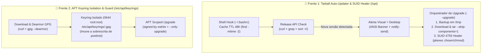

# 🐧 Linux Binary Auto-Updater, SUID Sandbox & APT Keyring Hardening

**Author:** Mariucha de Paula Rocha — *DevOps & SRE Engineer*  
⚖️ **Copyright © 2026 Mariucha de Paula Rocha — All Rights Reserved ([`LICENSE`](../LICENSE))**

> 🔒 **Intellectual Property & Live Demo Notice:**  
> Este documento apresenta a arquitetura de engenharia, o diagnóstico de causa raiz (RCA) e os mecanismos de automação de binários Linux e blindagem APT. Os scripts executáveis completos (`opt_tarball_updater.sh` e `apt_keyring_guard.sh`) residem no repositório privado da autora e são demonstrados **ao vivo durante entrevistas técnicas**.

---

## 🇧🇷 1. Escopo Executivo & Problemas de Engenharia Resolvidos (Português)

Em estações de trabalho e servidores Linux (**Ubuntu / Debian**), a manutenção de binários de terceiros em `/opt` e de repositórios APT externos apresenta dois desafios clássicos de engenharia de sistemas e segurança:

### Caso 1: Aplicações Electron/Chromium em `/opt` (Falha de Auto-Update + Quebra do `chrome-sandbox` SUID `4755`)
* **Causa Raiz 1 (Bloqueio do `electron-updater`):** Aplicações Electron distribuídas como tarball (`.tar.gz`) e extraídas em `/opt/<app>` não conseguem se auto-atualizar no Linux porque o `electron-updater` exige a variável de ambiente `APPIMAGE` (`[warn] APPIMAGE env is not defined, current application is not an AppImage`).
* **Causa Raiz 2 (Abort por SUID Sandbox):** Ao extrair um novo `.tar.gz` sobre `/opt/<app>`, o binário `chrome-sandbox` herda permissões do usuário comum (`0755`). Contudo, o Chromium exige que `chrome-sandbox` pertença a **`root:root`** com o bit **SUID ativo (`chmod 4755` / `-rwsr-xr-x`)** para isolar processos em namespaces seguros. Sem isso, o aplicativo aborta com:
  `FATAL:setuid_sandbox_host.cc — The SUID sandbox helper binary was found, but is not configured correctly`.

### Caso 2: Loop Infinito de Falso Update no APT por Sobrescrita de Chave GPG em `.postinst`
* **Causa Raiz:** Quando um fornecedor rotaciona sua subchave GPG de assinatura de pacotes `.deb`, mas mantém no script pós-instalação do pacote (`/var/lib/dpkg/info/<pkg>.postinst`) um payload `base64` legado que sobrescreve `/etc/apt/trusted.gpg.d/<repo>.gpg` de volta para a chave antiga revogada:
  1. O `apt update` falha na verificação criptográfica (`NO_PUBKEY` / `EXPKEYSIG`), mas **retorna exit code `0`** usando o índice antigo em cache.
  2. O `apt install` lê o cache desatualizado, assume que já está na versão mais recente e reinicia o binário antigo em **loop infinito**.

---

## 🏗️ 2. Arquitetura da Solução

---

## 🔬 3. Componentes do Módulo

| Arquivo | Descrição Técnica |
| :--- | :--- |
| **`opt_tarball_updater.sh`** | Script com 3 modos (`--check`, `--force-check` e `--upgrade`). No modo `--check` (ideal para `~/.bashrc`), usa cache de 48h (`find -mtime -2`), comparação semântica (`sort -V`) e `notify-send`. No modo `--upgrade`, realiza backup em `/tmp`, download e extração in-place (`tar --strip-components=1`) e restaura atomicamente `root:root` + `chmod 4755` no `chrome-sandbox` via `pkexec`. |
| **`apt_keyring_guard.sh`** | Converte a chave pública oficial via `gpg --dearmor`, instala no diretório isolado `/etc/apt/keyrings/<repo>.gpg` (`0644 root:root`), fixa o `signed-by` estrito em `/etc/apt/sources.list.d/` e executa actualización escopada (`--only-upgrade`) imune a regressões de `.postinst`. |

---

## 🛠️ 4. Comandos Linux de Engenharia Demonstrados

| Comando / Técnica Linux | Função no Projeto | Por que é uma Boa Prática SRE / Linux? |
| :--- | :--- | :--- |
| **`find "$cache" -mtime -2`** | Controle de TTL de cache (48 horas) | Evita requisições HTTP a cada abertura de terminal, mantendo `0ms` de latência no shell. |
| **`printf '%s\n%s\n' "$v1" "$v2" \| sort -V`** | Comparação semântica de versões (*SemVer*) | Compara corretamente versões multi-dígito (`1.9.0` vs `1.10.0`) sem falsos alertas. |
| **`tar --strip-components=1 -xzf`** | Extração limpa in-place em `/opt` | Substitui binários sem criar subdiretórios aninhados e sem falhar em pastas não-vazias. |
| **`chmod 4755` (`-rwsr-xr-x`)** | Ativação do bit **SUID** no `chrome-sandbox` | Garante que o sandbox do Chromium possa inicializar namespaces de segurança com privilégio efetivo `root`. |
| **`pkexec sh -c '...'`** | Elevação gráfica/sessão via PolicyKit | Aplica o Princípio do Menor Privilégio: download e extração ocorrem sem `root`, elevando permissão apenas para o `chown`/`chmod` final. |
| **`gpg --dearmor` + `/etc/apt/keyrings/`** | Isolamento criptográfico de chaves APT | Segue o padrão moderno Debian/Ubuntu e impede que scripts `.postinst` sobrescrevam chaves rotacionadas. |

---

## 🇺🇸 5. English Overview

1. **`opt_tarball_updater.sh` — Non-Blocking Tarball Update Notifier & SUID Sandbox Healer:**
   * Solves two Linux limitations for `/opt`-installed Electron/Chromium tarballs: missing `APPIMAGE` auto-update support and broken `chrome-sandbox` SUID bits after manual extraction.
   * Implements a 48-hour cached check (`find -mtime -2`), semantic version sorting (`sort -V`), desktop notifications (`notify-send`), automated `/tmp` backups, in-place extraction (`tar --strip-components=1`), and PolicyKit (`pkexec`) SUID restoration (`chown root:root` + `chmod 4755`).
2. **`apt_keyring_guard.sh` — APT Cryptographic Keyring Isolation:**
   * Prevents infinite false-update loops caused by legacy `.deb` `.postinst` scripts overwriting `/etc/apt/trusted.gpg.d/` with revoked GPG subkeys.
   * Isolates dearmored OpenPGP keys in `/etc/apt/keyrings/` (`0644 root:root`), enforces strict `[signed-by=...]` pinning, and runs scoped repository updates (`-o Dir::Etc::sourcelist=...`).
