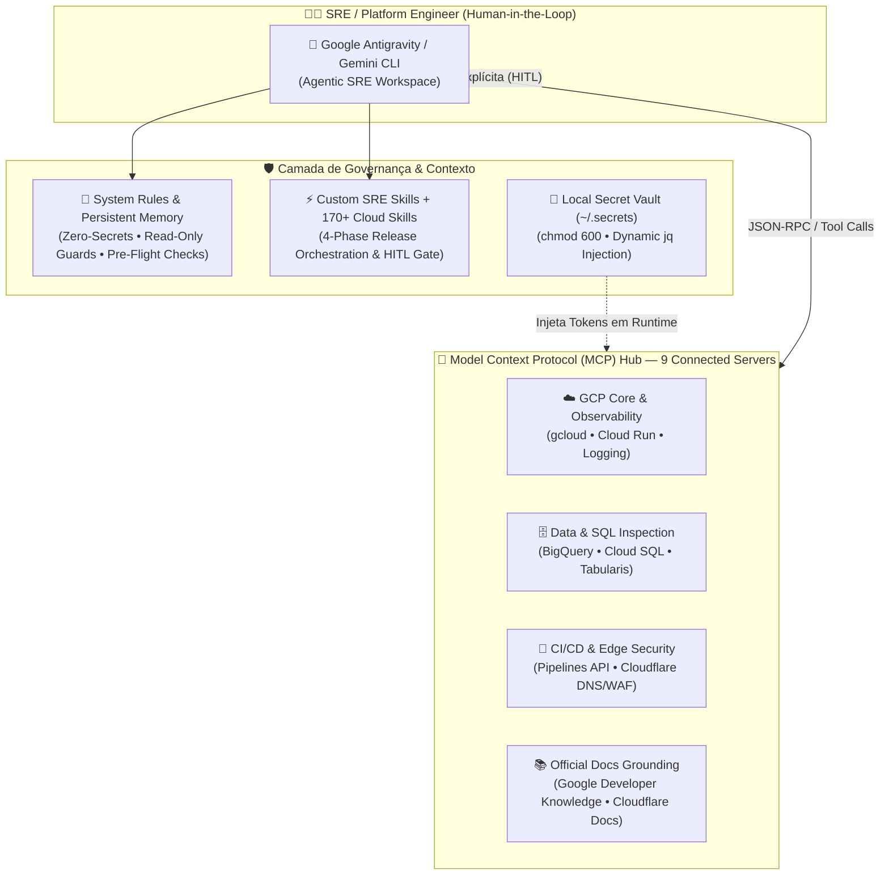
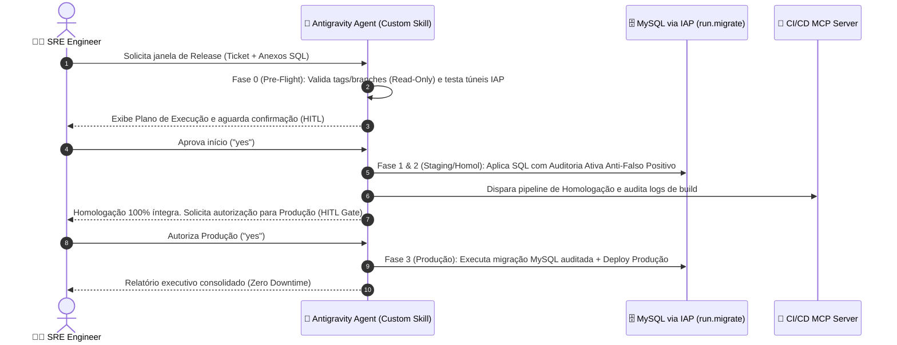

# 🤖 AI-Driven SRE & Platform Engineering via Agentic Workflows (`Google Antigravity` & `MCP`) — Architecture Case Study

**Author:** Mariucha de Paula Rocha — *DevOps & SRE Engineer*  
⚖️ **Copyright © 2026 Mariucha de Paula Rocha — All Rights Reserved ([`LICENSE`](../LICENSE))**

> 🔒 **Intellectual Property & Live Demo Notice:**  
> Este documento apresenta a arquitetura de **Engenharia SRE Agêntica (*AI-Driven SRE*)**, a matriz de governança de **9 servidores Model Context Protocol (MCP)**, o fluxo determinístico de orquestração de releases com trava **Human-in-the-Loop (HITL)** e trechos de automação (*snippets*). Os scripts executáveis de injeção e definições completas de Skills residem no repositório privado da autora e são demonstrados **ao vivo durante entrevistas técnicas**.

---

## 🇧🇷 1. O Problema de Engenharia & Escopo da Solução (Português)

Na operação moderna de **DevOps, Cloud e Site Reliability Engineering (SRE)**, a adoção ad-hoc de Inteligência Artificial sem arquitetura de plataforma introduz três riscos críticos:
1. **Exposição de Credenciais (*Secrets Leakage*):** Engenheiros colando tokens de API, chaves de nuvem ou strings de conexão em prompts, ou versionando credenciais em texto puro dentro de arquivos de configuração (`.json`).
2. **Ações Destrutivas sem Governança:** Agentes autônomos disparando pipelines de CI/CD, alterando regras de DNS/WAF ou aplicando migrações de banco de dados sem validação prévia (*Pre-Flight*) e sem aprovação humana (*Human-in-the-Loop*).
3. **Deriva de Contexto Operacional (*Context Drift*):** A cada nova sessão de troubleshooting, o assistente desconhece a topologia real da nuvem (GCP/AWS), repetindo comandos inseguros ou violando limites de escopo entre Infraestrutura e Desenvolvimento.

### A Solução Arquitetada (`06-agentic-sre-workflows-mcp`)
Uma arquitetura local de **AI-Driven SRE & Platform Engineering** construída sobre o **Google Antigravity & Gemini CLI**, sustentada por **3 Pilares de Governança**:
1. **Hub Multi-MCP com Cofre Isolado (*Zero Secrets*):** Integração de **9 servidores MCP (*Model Context Protocol*)** conectando Google Cloud Platform, BigQuery, Cloud SQL, Bancos de Dados via IAP, Cloudflare e CI/CD. Os tokens nunca residem no Git: são injetados dinamicamente via `jq` a partir de um cofre local restrito (`~/.secrets/secrets.sc` com `chmod 600`).
2. **Orquestração de Releases em 4 Fases com Trava *Human-in-the-Loop (HITL)*:** Uso de *Custom Agentic Skills* para conduzir janelas de deploy (Pré-Voo, Staging, Homologação e Produção), onde o agente audita scripts SQL, valida tags/branches e inspeciona logs de build, mas **bloqueia qualquer mutação em produção até receber confirmação explícita da engenheira**.
3. **Memória Arquitetural Persistente & Catálogo de Cloud Skills:** Sincronização de **170+ Google Cloud Skills** combinadas com diretrizes globais (`System Rules`) que impõem modo `Read-Only` em repositórios de código de aplicação e exigem validação sintática (`bash -n` e `python -m py_compile`) antes de qualquer commit de infraestrutura.

---

## 🗺️ 2. Arquitetura do Ecossistema Agêntico (Google Antigravity + 9 MCP Servers)



---

## 📊 3. Matriz de Integração e Segurança dos 9 Servidores MCP

| Categoria | Servidor MCP | Escopo Operacional no Fluxo SRE | Guardrail de Segurança |
| :--- | :--- | :--- | :--- |
| **Cloud & Infra** | `gcloud-remote` | Inspeção de instâncias GCE (ARM64/x86), Cloud Run Jobs, IAM e Cloud Logging | Autenticação via ADC / OAuth sem chaves estáticas |
| **Data & Analytics** | `datacloud_bigquery` | Auditoria de datasets analíticos, billing export (FinOps) e jobs SQL | Modo `execute_sql_readonly` priorizado |
| **Managed Databases** | `datacloud_cloud-sql` | Diagnóstico de instâncias gerenciadas, backups e prechecks de upgrade | Bloqueio de operações destrutivas sem HITL |
| **Data Governance** | `knowledge_catalog` | Descoberta de metadados, linhagem e políticas IAM de datasets | Consulta estruturada de catálogo |
| **Database Inspector** | `tabularis` | Inspeção de schemas (`describe_table`) e queries diagnósticas via túnel IAP | Conexão local exclusiva (`127.0.0.1`) |
| **CI/CD Pipelines** | `cicd-pipelines` | Listagem de pipelines, inspeção de logs de build/deploy e trigger controlado | Trava HITL obrigatória antes de `run-pipeline` |
| **Edge & DNS/WAF** | `cloudflare-edge` | Auditoria de registros DNS, regras de WAF e certificados Origin SSL | Token com escopo restrito injetado via cofre local |
| **Cloud Docs (GCP)** | `developer-knowledge` | Grounding em tempo real na documentação oficial do Google Cloud | Prevenção de alucinação em sintaxes de CLI/API |
| **Edge Docs** | `cloudflare-docs` | Consulta de referência oficial de Workers, DNS e segurança de borda | Zero dependência de conhecimento defasado |

---

## 🔄 4. Fluxo de Orquestração de Releases em 4 Fases (Custom SRE Skill + HITL)



---

## 💻 5. Destaque de Engenharia (*Snippet*) — Injeção Zero-Secrets via `jq`

Para impedir que tokens de CI/CD ou provedores de borda fiquem expostos em histórico de comandos ou arquivos versionados, a injeção no arquivo de configuração MCP ([ver template `mcp_config.example.json`](./mcp_config.example.json)) ocorre de forma atômica e com permissão restrita (`chmod 600`):

```bash
# Copyright (c) 2026 Mariucha de Paula Rocha - All Rights Reserved
# Injeção segura de credenciais do Cofre Local (~/.secrets/secrets.sc) no MCP Config via jq:
set -euo pipefail

SECRETS_FILE="${HOME}/.secrets/secrets.sc"
MCP_CONFIG="${HOME}/.gemini/config/mcp_config.json"

chmod 600 "${SECRETS_FILE}"
# shellcheck source=/dev/null
source "${SECRETS_FILE}"

jq --arg cicd_token "${CICD_API_TOKEN}" \
   --arg cf_token "${CLOUDFLARE_API_TOKEN}" \
   '.mcpServers["cicd-pipelines"].env.API_TOKEN = $cicd_token |
    .mcpServers["cloudflare-edge"].env.CLOUDFLARE_API_TOKEN = $cf_token' \
   "${MCP_CONFIG}" > "${MCP_CONFIG}.tmp" && \
mv "${MCP_CONFIG}.tmp" "${MCP_CONFIG}" && \
chmod 600 "${MCP_CONFIG}"
```

---

## 🇺🇸 6. Executive Summary (English)

* **Problem:** Ad-hoc AI usage in DevOps/SRE risks credential leakage in configuration files, unverified automated actions in production, and loss of architectural context across sessions.
* **Solution:** Built an **AI-Driven SRE & Platform Engineering** workflow on **Google Antigravity & Gemini CLI**, integrating **9 Model Context Protocol (MCP) servers** (GCP, BigQuery, Cloud SQL, Tabularis DB over IAP, CI/CD, Cloudflare, and official documentation grounding), **170+ Google Cloud Skills**, and custom **4-Phase Release Orchestration Skills** with strict **Human-in-the-Loop (HITL)** approval gates and `jq`-based Zero-Secrets injection (`chmod 600`).
