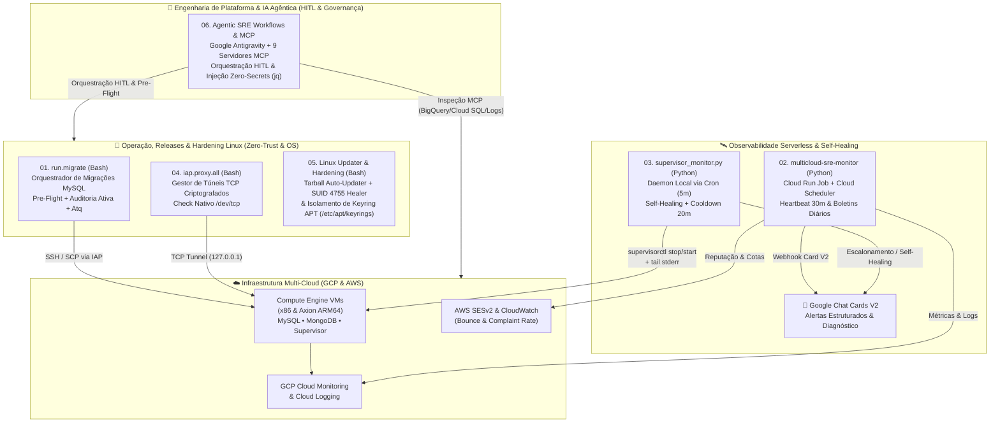

# 🛰️ Cloud SRE, DevOps & Automation Engineering Portfolio

**Author:** Mariucha de Paula Rocha — *DevOps & SRE Engineer*  
🔗 **LinkedIn:** [linkedin.com/in/mariucha-rocha-937b3b8b](https://www.linkedin.com/in/mariucha-rocha-937b3b8b) | 💻 **GitHub:** [github.com/Mariucha0912](https://github.com/Mariucha0912)

---

## 🇧🇷 Visão Geral (Português)

Este repositório reúne ferramentas de **Engenharia de Confiabilidade (SRE)**, **Automação de Bancos de Dados em Linux**, **Observabilidade Serverless Multi-Cloud (GCP & AWS)**, **Auto-Healing de Processos**, **Conectividade Segura Zero-Trust (GCP IAP)** e **Engenharia SRE Agêntica (Google Antigravity & MCP)** desenvolvidas em **Python** e **Bash** para operação de ambientes SaaS multi-tenant e dedicados em produção.

> 🛡️ **Nota de Segurança, Propriedade Intelectual & Demonstração Ao Vivo (`© 2026 Mariucha de Paula Rocha — Todos os Direitos Reservados`):**  
> Este repositório público atua como **Vitrine de Arquitetura e Estudo de Caso (*Architecture Case Study*)**, apresentando diagramas de engenharia, análises de causa raiz (RCA), matrizes de comandos e trechos selecionados (*snippets*). Para proteção de propriedade intelectual ([ver `LICENSE`](./LICENSE)), os scripts executáveis completos residem em repositório privado da autora e são demonstrados **ao vivo durante entrevistas técnicas**. Nomes de projetos e instâncias utilizam identificadores genéricos (`acme-*-pool`).

### 🏛️ Arquitetura do Ecossistema

---

### 📂 Módulos do Repositório

| Diretório | Tecnologia | Descrição Técnica |
| :--- | :--- | :--- |
| **[`01-mysql-iap-migrator/`](./01-mysql-iap-migrator)** | `Bash` • `MySQL` • `GCP IAP` • `Linux at/atd` | Orquestrador central (`run.migrate v3.3`) para aplicação imediata (*OnDemand*), agendada (`at`/`atd`) e painel global de filas (`atq`) em múltiplas instâncias Linux via túnel IAP. Inclui *pre-flight checks* em 4 etapas, automação FinOps de ciclo de vida de VMs e **auditoria ativa anti-falso positivo** com diagnóstico contextual de erros nativos do MySQL (`1045`, `1062`, `1142`, `1146`, etc.). 📖 **[Ver Arquitetura "Debaixo do Capô" (Comando por Comando)](./01-mysql-iap-migrator/README.md)** |
| **[`02-multicloud-sre-monitor/`](./02-multicloud-sre-monitor)** | `Python 3.12` • `Docker` • `Cloud Run Jobs` • `AWS Boto3` | Monitoramento serverless executado via **Google Cloud Run Jobs** e **Cloud Scheduler** (modo *Heartbeat* silencioso a cada 30 min e boletins diários). Coleta métricas de CPU/Uptime no **GCP Cloud Monitoring**, diagnostica logs no **Cloud Logging**, audita reputação de e-mails no **AWS SESv2/CloudWatch** (`BounceRate` e `ComplaintRate`) e dispara **Google Chat Cards V2**. 📖 **[Ver Estudo de Caso & Arquitetura Multi-Cloud](./02-multicloud-sre-monitor/README.md)** |
| **[`03-supervisor-self-healing/`](./03-supervisor-self-healing)** | `Python 3` • `Supervisor` • `Linux Cron` | Rotina de autorrecuperação local (`supervisor_monitor.py`) agendada via Crontab (a cada 5 minutos) para monitorar workers críticos no Supervisor. Executa restart cirúrgico em 2 etapas (`stop` ➔ `sleep` ➔ `start`), coleta automática das últimas linhas de `stderr`, controle de estado JSON com **trava anti-ruído (*cooldown* de 20 min)** e escalonamento após 3 falhas consecutivas. 📖 **[Ver Estudo de Caso & Máquina de Estados](./03-supervisor-self-healing/README.md)** |
| **[`04-gcp-iap-tunnel-manager/`](./04-gcp-iap-tunnel-manager)** | `Bash` • `GCP IAP` • `TCP Sockets` | Gerenciador CLI (`iap.proxy.all`) para múltiplos túneis TCP criptografados (`gcloud compute start-iap-tunnel`) para acesso seguro a bancos MySQL e MongoDB sem exposição de IPs públicos, utilizando verificação nativa de descritores `/dev/tcp/127.0.0.1/<PORT>` e proteção contra processos duplicados. 📖 **[Ver Estudo de Caso & Topologia Zero-Trust](./04-gcp-iap-tunnel-manager/README.md)** |
| **[`05-linux-system-updater-and-hardening/`](./05-linux-system-updater-and-hardening)** | `Bash` • `Linux SUID (4755)` • `PolicyKit` • `APT GPG` | Automação de ciclo de vida de binários em `/opt` (`opt_tarball_updater.sh` com cache TTL 48h `find -mtime -2`, `sort -V`, backup em `/tmp` e auto-healing de SUID Sandbox `4755` via `pkexec`) + isolamento criptográfico de keyrings APT (`apt_keyring_guard.sh` em `/etc/apt/keyrings/`) contra loops de falso update por scripts `.postinst`. 📖 **[Ver Escopo Técnico & Causa Raiz](./05-linux-system-updater-and-hardening/README.md)** |
| **[`06-agentic-sre-workflows-mcp/`](./06-agentic-sre-workflows-mcp)** | `Google Antigravity` • `MCP` • `Gemini CLI` • `jq` | Arquitetura de **AI-Driven SRE & Platform Engineering** integrando **9 servidores Model Context Protocol (MCP)** (GCP, BigQuery, Cloud SQL, Tabularis DB via IAP, CI/CD, Cloudflare e documentação oficial), **170+ Cloud Skills**, injeção atômica Zero-Secrets (`jq` + `chmod 600`) e orquestração de releases em 4 fases com trava **Human-in-the-Loop (HITL)**. 📖 **[Ver Arquitetura Agêntica & Matriz dos 9 Servidores MCP](./06-agentic-sre-workflows-mcp/README.md)** |

---
---

## 🇺🇸 Overview (English)

This repository showcases production-grade **Site Reliability Engineering (SRE)**, **Linux Database Automation**, **Multi-Cloud Serverless Observability (GCP & AWS)**, **Process Self-Healing**, **Zero-Trust Access (GCP IAP)**, and **AI-Driven SRE Workflows (Google Antigravity & MCP)** written in **Python** and **Bash** for multi-tenant and dedicated SaaS environments.

> 🛡️ **Intellectual Property, Security & Live Demo Notice (`© 2026 Mariucha de Paula Rocha — All Rights Reserved`):**  
> This public repository serves as an **Architecture Showcase & Engineering Case Study**, presenting system diagrams, root cause analyses (RCA), operational command matrices, and selected code snippets. To protect intellectual property ([see `LICENSE`](./LICENSE)), full executable source codes are maintained in the author's private repository and are demonstrated **live during technical interviews**.

### 📂 Repository Modules

1. **[`01-mysql-iap-migrator/`](./01-mysql-iap-migrator) (`run.migrate v3.3` — Bash):**
   Centralized database migration orchestrator over GCP Identity-Aware Proxy (IAP) tunnels. Features 4-stage pre-flight checks, *OnDemand* and *Scheduled* execution (`at`/`atd`), a real-time global queue manager (`atq`), FinOps VM lifecycle automation (auto-start/stop for staging/template instances), and real-time MySQL error stream auditing to prevent false-positive deployments. ([📖 Read Under-the-Hood Architecture Docs](./01-mysql-iap-migrator/README.md))
2. **[`02-multicloud-sre-monitor/`](./02-multicloud-sre-monitor) (`main.py` — Python, Docker, Cloud Run Jobs):**
   Serverless multi-cloud observability job triggered by Google Cloud Scheduler (30-minute silent heartbeats + 3 daily health reports). Aggregates GCP Cloud Monitoring metrics (CPU, Uptime Checks, Compute Engine worker health), Cloud Logging error pattern matching, and AWS SESv2/CloudWatch email reputation indicators (`BounceRate`, `ComplaintRate`), dispatching interactive Google Chat Cards V2. ([📖 Read Multi-Cloud Architecture Case Study](./02-multicloud-sre-monitor/README.md))
3. **[`03-supervisor-self-healing/`](./03-supervisor-self-healing) (`supervisor_monitor.py` — Python, Linux Cron):**
   Automated self-healing watchdog running every 5 minutes via Crontab on Linux production hosts. Inspects `supervisorctl status`, performs clean 2-step process restarts (`stop` ➔ `sleep 1s` ➔ `start`), captures tail `stderr` logs, enforces a 20-minute alert cooldown to prevent alert fatigue, and escalates chronic failures after 3 consecutive unsuccessful attempts. ([📖 Read Self-Healing Architecture Case Study](./03-supervisor-self-healing/README.md))
4. **[`04-gcp-iap-tunnel-manager/`](./04-gcp-iap-tunnel-manager) (`iap.proxy.all` — Bash):**
   Zero-Trust TCP tunnel manager wrapping `gcloud compute start-iap-tunnel` for local database administration (MySQL, MongoDB) without public IPs. Uses native Bash `/dev/tcp` socket probing for instant health checks and idempotent background startup. ([📖 Read Zero-Trust Tunnel Architecture Case Study](./04-gcp-iap-tunnel-manager/README.md))
5. **[`05-linux-system-updater-and-hardening/`](./05-linux-system-updater-and-hardening) (`opt_tarball_updater.sh` & `apt_keyring_guard.sh` — Bash, Linux SUID & APT Security):**
   Linux systems engineering suite solving two real-world OS lifecycle bottlenecks: automated `/opt` tarball updates with 48h TTL caching (`find -mtime -2`), semantic version sorting (`sort -V`), and PolicyKit (`pkexec`) SUID `4755` restoration for `chrome-sandbox`; plus cryptographic APT keyring isolation (`/etc/apt/keyrings/`) against `.deb` `.postinst` GPG key regression loops. ([📖 Read Technical Scope & Root Cause Docs](./05-linux-system-updater-and-hardening/README.md))
6. **[`06-agentic-sre-workflows-mcp/`](./06-agentic-sre-workflows-mcp) (`Google Antigravity`, `Model Context Protocol - MCP` & `jq` — AI-Driven SRE):**
   Agentic SRE & Platform Engineering governance layer integrating **9 MCP servers** (GCP, BigQuery, Cloud SQL, Tabularis DB over IAP, CI/CD, Cloudflare, and official documentation grounding), **170+ Google Cloud Skills**, atomic Zero-Secrets credential injection (`jq` + `chmod 600`), and 4-phase release orchestration with mandatory **Human-in-the-Loop (HITL)** approval gates. ([📖 Read Agentic SRE & MCP Architecture Case Study](./06-agentic-sre-workflows-mcp/README.md))

---

⚖️ **Copyright © 2026 Mariucha de Paula Rocha — All Rights Reserved.**  
*Unauthorized copying, cloning for operational/commercial use, modification, or redistribution of any architecture design, documentation, or snippet in this repository is strictly prohibited without prior written consent from the author. See [`LICENSE`](./LICENSE) for full terms.*
